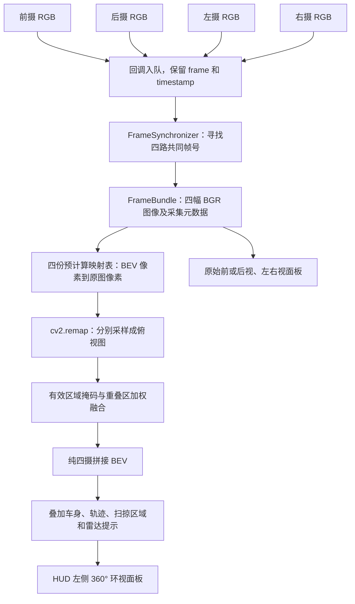

# 四摄 360° 环视拼接：代码逻辑说明

本文说明当前项目实际运行的四摄环视实现。启动命令见[项目 README](../../README.md#启动流程)。

**左侧环视由前、后、左、右四路 RGB 相机实时拼接生成，没有额外的车顶俯拍摄像头。** 中央货车轮廓、轨迹、扫掠区域和距离标签是程序叠加的信息，不属于摄像头原始画面。

当前算法是**已知相机几何参数的地面逆透视映射（IPM）加权融合**。它把四路透视图中的地面映射到同一个俯视平面，不做全景球面拼接，也不做完整三维重建。

## 1. 整体数据流程



| 职责 | 代码位置 |
|---|---|
| 相机分辨率、FOV、安装高度等参数 | [config.py](../../config.py) |
| 依据运行时车身几何计算四摄安装位姿 | [camera_mounts()](../../perception/bev_stitcher.py) |
| 创建相机、接收图像、转为 BGR | [SensorManager](../../core/sensor_manager.py) |
| 按相同 frame 编号组帧 | [FrameSynchronizer / FrameBundle](../../core/frame_sync.py) |
| 相机内参、旋转基向量与投影数学 | [camera_math.py](../../utils/camera_math.py) |
| 预计算 BEV 映射、采样和融合 | [BevStitcher](../../perception/bev_stitcher.py) |
| 主循环和车身、轨迹覆盖层 | [main.py](../../main.py) |
| 环视及原始相机面板显示 | [Hud](../../visualization/hud.py) |

## 2. 先明确坐标系

### 车辆局部坐标

原点是 CARLA 车辆 actor 原点，**不能默认等于后轴或车身几何中心**：

- `+X`：向车头。
- `+Y`：向车身右侧。
- `+Z`：向上。

四摄安装位置、地面平面和轨迹最终都使用这个坐标系。轴位置、车身包络及地面高度由运行时车辆信息确定；本车模型还有实测得到的保守车尾碰撞包络修正。

### 图像坐标

相机原始图像中的 `(u, v)`：`u` 向右、`v` 向下。

BEV 图像中的 `(U, V)`：`U` 向右对应车辆右侧，`V` 向下对应车尾。因此 BEV 顶部始终是车头方向，车辆转弯时显示仍以自车为参考。

处理链内部统一使用 **BGR**，到 pygame 显示时再按支持的像素格式生成 Surface。

## 3. 四个摄像头是怎样安装的

`main.run()` 先读取车辆几何，再调用 `camera_mounts(geometry)`，把同一份安装参数同时交给：

1. `SensorManager`：在 CARLA 中生成真正的相机。
2. `BevStitcher`：计算这些相机对应的投影映射。

这样避免“模拟器相机位置”和“拼接计算假定的位置”分别配置而不一致。

记车身包络边界为 `xmin/xmax/ymin/ymax`，车身名义中心为 `(cx, cy)`，局部地面高度为 `zg`。当前运行路径的安装规则为：

| 相机 | 安装位置 `(x, y, z)`，米 | `(pitch, yaw, roll)`，度 |
|---|---|---|
| 前 | `(xmax + 0.25, cy, zg + 3.0)` | `(-45, 0, 0)` |
| 后 | `(xmin - 0.25, cy, zg + 3.0)` | `(-45, 180, 0)` |
| 左 | `(cx, ymin - 0.10, zg + 3.0)` | `(-45, -90, 0)` |
| 右 | `(cx, ymax + 0.10, zg + 3.0)` | `(-45, 90, 0)` |

当前四摄均为 `sensor.camera.rgb`，分辨率 **960×600**，水平 FOV **130°**。相机向外、向下看，安装点适当外扩以减少自车遮挡。该规则不是额外增加空中相机。

`SensorManager` 将 `sensor_tick` 设为 `0.0`，使传感器按仿真步输出；同时将支持的 `lens_k`、`lens_kcube` 设为零，配合当前针孔投影模型。这里不是用鱼眼标定或图像特征匹配自动寻找接缝。

注意：`config.py` 中保留了部分旧安装参数，但正常主程序显式传入的是运行时 `camera_mounts()` 的结果。阅读和调参应以这条实际调用链为准。

## 4. 为什么要先把四路图像配成同一帧

CARLA 回调是异步到达的。即使仿真采用固定 20 Hz 步长，也不能假定四路“各自最新图像”一定属于同一时刻。

当前实现分两层缓存：

1. 相机回调只把 `carla.Image` 放入有界线程安全队列；满时丢最旧数据。
2. 主线程把数据送入 `FrameSynchronizer`，按 `frame` 编号保存。

`pop_common()` 的核心逻辑为：

```python
common = set.intersection(*(set(frames) for frames in pending.values()))
if not common:
    return None
frame = max(common)
# 返回每个相机的这个 frame，并清理不晚于它的缓存。
```

例如前摄只有 100 帧、后摄只有 101 帧时，不会把它们拼在一起；等四路都具有 101 帧后，才输出这一组。缓存容量有限，旧组也不会在已经显示新帧后倒退显示。

组成完整组后，`SensorManager.get_bundle()` 解码 CARLA 的 BGRA 缓冲，通过 `cv2.COLOR_BGRA2BGR` 转成 BGR，并返回：

```python
FrameBundle(
    frame=共同帧号,
    timestamp=采集时间,
    images={"front": ..., "rear": ..., "left": ..., "right": ...},
    transforms={相机名: 采集时的相机世界位姿},
)
```

正常主循环非阻塞地取新组；暂时没凑齐就保留上一次完整组，不混入其他帧。界面按图像年龄显示状态，过期后停止在旧图上叠加动态位置提示。

## 5. 从 BEV 的每个像素，反过来寻找原图像素

当前采用**输出图反查输入图**：先确定 BEV 某个像素代表地面上的哪一点，再问这点会投影到每台摄像头的哪个像素。

这是 `cv2.remap` 需要的映射方向。不是把原图像素逐个“扔到”俯视画布上，后者容易因为采样间隔出现空洞。

### 5.1 BEV 像素 → 车辆地面点

记 BEV 宽高为 `Wb/Hb`，像素密度为 `s`，单位是像素/米：

```text
x = (Hb / 2 - V) / s
y = (U - Wb / 2) / s
z = zg
```

上式的 `x/y/z` 均在车辆局部坐标系。代码的默认像素密度为：

```text
s = Hb / (2 × BEV_RANGE_M)
```

`BEV_RANGE_M = 9.0`，所以纵向覆盖约前后各 9 米；横向范围由画布宽高比决定，不能把纵向矩形画布误认为横纵都覆盖 ±9 米。

主界面目前以宽 **400 像素**计算 BEV，高度按面板比例确定，在 1920×1080 默认窗口下约为 **603 像素**，然后等比显示。此时 `s ≈ 33.5 px/m`，左右各覆盖约 5.97 米。例如前方 3 米、右侧 2 米的地面点，大约落到 BEV 像素 `(267, 201)`。

横纵始终使用同一个 `s`，因此车身宽高和距离不会因面板比例不同而被任意拉伸。

### 5.2 地面点 → 每台相机像素

首先由分辨率和水平 FOV 构造相机内参：

```text
fx = fy = (image_width / 2) / tan(horizontal_fov / 2)
cx_pixel = image_width / 2
cy_pixel = image_height / 2
```

当前约为 `fx = fy = 223.83` 像素、主点 `(480, 300)`；公式中的 FOV 计算时须转为弧度。

对地面点 `P`，相机安装位置为 `C`，安装旋转生成三个单位基向量：`forward`、`right`、`up`：

```text
d = P - C
depth = dot(d, forward)
u = cx_pixel + fx × dot(d, right) / depth
v = cy_pixel - fy × dot(d, up) / depth
```

`v` 式的负号来自图像向下为正、相机 `up` 向上为正。

本项目使用 `carla_rotation_to_basis()` 构造这些基向量。在线测试发现本机 CARLA 构建的 `get_matrix()` 绑定与实际变换方向存在差异，因此不能随手用该 API 的矩阵替换当前基向量计算。

### 5.3 预计算映射表

车辆上的相机相对安装位置不变，BEV 又采用固定局部平面，所以这些映射在 `BevStitcher.__init__()` 中计算一次，保存为：

```python
self._maps[camera_key] = (u_map, v_map, weight_map)
```

每张表尺寸均为 `Hb×Wb`：

- `u_map[V, U]`：该 BEV 像素应该从原图的哪一列取样。
- `v_map[V, U]`：该 BEV 像素应该从原图的哪一行取样。
- `weight_map[V, U]`：这台相机对此 BEV 像素的贡献权重，零表示无效。

每帧只需取图、查表、采样和融合，不必重复推导投影关系。

## 6. 哪些投影允许参与拼接

不能只计算出 `(u, v)` 就认定它有效。当前掩码要求：

- 点在相机前方，`depth > 0.02` 米。
- 投影在原图有效范围：`0 ≤ u < width - 1`、`0 ≤ v < height - 1`。
- 点位于这台摄像头负责的车身外侧。

最后一项对应代码中的 `visible_side`：

| 相机 | 允许参与的地面区域 |
|---|---|
| 前 | `x ≥ xmax` |
| 后 | `x ≤ xmin` |
| 左 | `y ≤ ymin` |
| 右 | `y ≥ ymax` |

车角可以同时满足两个条件，例如右前角同时由前摄和右摄贡献。车身内部不会被假装填成透明底盘。

该掩码是几何视场及车身侧别约束，**不是完整三维遮挡检测**。它无法保证某个投影点在真实图像中没有被墙、车或柱子遮住。

## 7. 每帧如何采样并融合

### 7.1 四路重映射

`BevStitcher.stitch(frames)` 遍历四幅 BGR 图像，调用：

```python
warped = cv2.remap(
    frame,
    u_map,
    v_map,
    cv2.INTER_LINEAR,
    borderMode=cv2.BORDER_CONSTANT,
)
```

这里 `INTER_LINEAR` 使用双线性插值：映射落在两个原图像素之间时，由附近像素插值得到颜色。

### 7.2 边缘权重

权重按照源图采样位置到图像四边的归一化距离计算：

```text
edge = min(
    u / (width/2),
    (width-1-u) / (width/2),
    v / (height/2),
    (height-1-v) / (height/2)
)

weight = clip(edge, 0.05, 1.0)    有效像素
weight = 0                      无效像素
```

源图中央贡献较大，边缘贡献较小。最低有效权重 0.05 避免有效边缘完全断开，但不会把无效像素变为有效。

当前不是“每个方向固定裁一块后硬贴”，也没有额外运行接缝搜索、曝光补偿或特征点配准算法；重叠区依靠这些固定几何权重过渡。

### 7.3 归一化融合

对 BEV 的每个像素，四路采样颜色为 `Ii`，权重为 `wi`：

```text
C = Σ(wi × Ii) / Σwi
```

实际代码为：

```python
color += warped.astype(np.float32) * weight[:, :, None]
weights += weight
blended = color / np.maximum(weights[:, :, None], 1e-6)
```

`last_coverage = weights > 0` 记录本帧哪些位置有图像贡献。完全没有相机覆盖的位置使用暗色斜纹底图，不复制相邻地面伪造可见区域。

## 8. 拼接完成后才添加车身和辅助信息

`stitch()` 的输出仅是相机融合图。主循环随后调用：

1. `build_bev_base()`：生成按车辆保守包络比例绘制的车身示意覆盖层。
2. `overlay_bev()`：叠加预测车身扫掠范围和轨迹，再覆盖中央车身示意。
3. `Hud.render()`：叠加雷达距离、提示线和检测点标记，显示到左侧环视面板。

因此：

- 中央货车轮廓不是第五台相机拍到的。
- 地面与周边环境来自四路 RGB 相机。
- 距离来自四雷达，不是通过 BEV 像素估出来的。
- 雷达不参与 RGB 拼接，也不会填补摄像头盲区。
- 原始前/后/左右视图和 BEV 使用同一组四摄图像；切换 D/R 改变右上主视图，不是换一套环视相机。

相机组可能比当前仿真状态晚一帧。位置标记会从当前车辆坐标换算到图像采集时的车辆坐标，避免车动以后把新位置直接画到旧地面图上。图像过期时暂停相关动态叠加，当前雷达数值仍可在底栏独立显示。

## 9. 用伪代码串起核心逻辑

以下为讲解用伪代码，省略事件处理、资源清理和诊断，不是另一套实现：

```python
geometry = read_vehicle_geometry()
mounts = camera_mounts(geometry)
cameras = SensorManager(manager, vehicle, mounts)
stitcher = BevStitcher(geometry=geometry, mounts=mounts, ...)
static_layer = build_bev_base(stitcher)

while running:
    frame = manager.tick()
    bundle = cameras.get_bundle(wait_s=0.0)
    if bundle is None:
        # 保留上一组完整图像，同时更新图像年龄及有效状态。
        bundle = previous_complete_bundle

    # 内部：四路 remap → 有效掩码 → 加权累积 → 归一化。
    camera_bev = stitcher.stitch(bundle.images)

    # 轨迹使用与图像帧相对应的车辆状态。
    bev = overlay_bev(camera_bev, static_layer, trajectory, stitcher, footprints)

    # 雷达独立测距，检测点转换到图像采集位姿后叠加。
    hud.render(bev, bundle.images, trajectory, radar_ranges, ...)
```

## 10. 当前方法的限制与调试入口

### 为什么立体物体会被拉长或重影

映射计算假设所有目标都在 `z = zg` 的地面平面上。道路标线等地面内容通常能对齐，但车、墙、柱子高于地面，它们的像素被当作地面处理后会拉伸，重叠区还可能产生两个不一致的轮廓。

这不是增加融合权重就能消除的问题。当前没有用深度进行三维重建，也没有为每个像素处理遮挡。真实鱼眼相机接入时，还需要相机标定、畸变处理及一致的内外参，不能直接照抄 CARLA 针孔参数。

### 平地假设与动态姿态

安装外参和局部地面高度在启动时确定；预计算映射不会逐帧拟合实际路面。车辆在明显坡道、起伏路面或悬架姿态变化较大时，拼接会有偏差。本版没有道路曲面自适应。

### 覆盖率是什么含义

`coverage_report()` 统计当前画布中，距离保守车身包络 0.15–4 米地面环带内有投影贡献的像素比例。它不等于：

- 雷达检测率。
- 真实三维无遮挡覆盖率。
- 车辆底部可见率。
- 所有场景都无盲区的保证。

### 如何核对拼接效果

按[启动流程](../../README.md#启动流程)运行并加上 `--save-frame`，对比输出的：

- `cam_front.png`、`cam_rear.png`、`cam_left.png`、`cam_right.png`：四路输入。
- `bev.png`：四摄融合及叠加结果。
- `hud.png`：最终界面。
- `setup.json`：本次实际相机安装位置和车辆几何，排查时以此为准。
- `telemetry.jsonl`：检查四摄共同帧号与图像年龄。

当前 `--save-frame` 的 `bev.png` 来自已叠加辅助信息的画布，不是裸 `stitch()` 输出；需要调试纯融合图时，应在 `stitcher.stitch()` 返回后、`overlay_bev()` 前观察。

本机已有真实 CARLA 转弯界面截图 `artifacts/live-final/views/turn_right/hud.png` 可供对照；图片按仓库规则未上传 GitHub，可运行截图命令重新生成。它与 `artifacts/preview/` 下明确标注的离线合成预览不同。

## 11. 修改时应注意的参数关系

| 需要改变什么 | 应修改/检查什么 |
|---|---|
| 相机安装位置、方向 | `camera_mounts()`，并保证同一 `mounts` 传给相机管理器与拼接器 |
| 图像尺寸、水平 FOV | `config.CAMERA_WIDTH_PX/HEIGHT_PX/FOV_DEG`；重启后重新生成相机及映射 |
| 相机高度、俯角 | `CAMERA_MOUNT_HEIGHT_M`、`CAMERA_PITCH_DEG`，检查近车覆盖和自车遮挡 |
| 环视前后范围 | `BEV_RANGE_M`；宽高比还会影响左右范围 |
| 环视计算分辨率 | `BEV_RENDER_WIDTH_PX` 与 `main.run()` 中画布高度计算，不能非等比拉伸 |
| 接缝融合 | `BevStitcher.__init__()` 中的 `weight` 与有效掩码 |
| 缺帧、错帧 | `SensorManager.get_bundle()`、`FrameSynchronizer` 与遥测中的 frame/age |

当前主程序使用预计算 `remap` 直接做地面映射。仓库中仍保留 `compute_ipm_homography()`、`IPM_CROP_BOTTOM_RATIO` 等旧版工具/参数，**不属于当前 `BevStitcher.stitch()` 的执行路径**，不能把旧版裁剪后 `warpPerspective` 的过程当作现有拼接实现。
